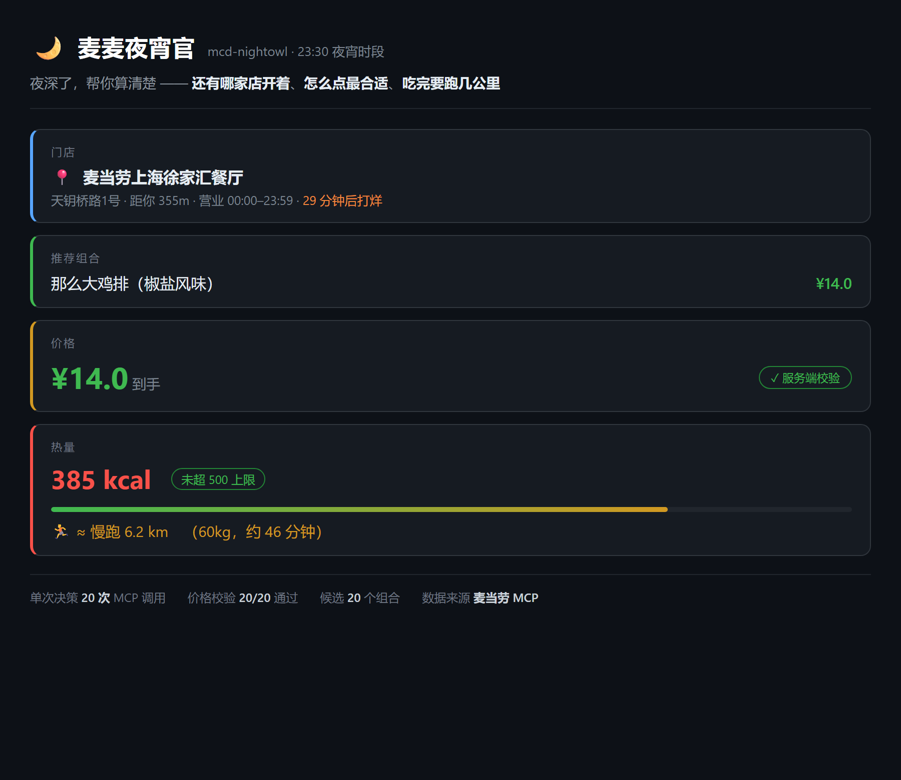

# 🌙 麦麦夜宵官 `mcd-nightowl`

<p align="center">
  
</p>

> **夜深了，帮你算清楚：还有哪家店开着、怎么点最合适、吃完要跑几公里。**

面向深夜场景（21:00–05:00）的麦当劳点餐决策 Skill，基于麦当劳 MCP 构建。

---

## 与同类项目的区别

深夜点餐类项目不止一个，本项目的差异全部来自实测，不是纸面设计：

| 能力 | 本项目 | 为什么别人难做到 |
|---|---|---|
| **门店营业状态判断** | ✅ 真实数据驱动 | `query-nearby-stores` 实测返回 `businessStatus` / `businessStartTime` / `businessEndTime`，据此实现营业过滤与打烊倒计时（含跨午夜、24 小时门店）——这三个字段多数项目没找到，只能放弃该功能 |
| **价格由服务端校验** | ✅ 20/20 通过 | 券的互斥规则、门店差异、时段限制只有服务端知道，本地算的价格不可信；本项目用 `calculate-price` 逐个校验候选组合，拿真实到手价 |
| **价格 × 热量帕累托前沿** | ✅ 多档输出 | 不是单一排序，而是在两个目标上求非支配解：最省 / 最均衡 / 最轻量，同时引入热量下限，避免最优解退化成一包 ¥3 的蘸酱 |
| **运动折算** | ✅ | 385 kcal ≈ 慢跑 6.2 km——把夜宵的代价换算成可感知的运动量 |

**一个实测细节**：如果只按价格排序，最优解永远是「韩式烟熏芝士风味酱 ¥3.0」。
所以本项目的束搜索按「能否吃饱（热量下限 = 时段上限 × 0.5）」分层排序，
单品池预先剔除蘸酱小料——这个坑我们踩过，修在了算法里。

---

## 为什么做这个

深夜点麦当劳有三个别人没解决的问题：

1. **不是选什么，是还有没有店。** 实测：上海奉贤 5 家门店最晚 23:00 全部打烊，
   只有市区少数门店营业到 23:59 或 24 小时。"这会儿还能不能吃"本身就是个需要计算的问题。
2. **便宜的不等于划算的。** 真正的问题是"预算内、能吃饱、热量不超标"的最优组合，
   这是个双目标优化问题，不是价格排序。
3. **吃完要跑几公里。** 夜宵的原罪是热量，把它换算成可感知的运动量，才能帮人做决定。

麦当劳官方在门店数据里其实提供了 `businessStatus`、营业起止时间，
以及「早餐/午餐/下午茶/夜市/**宵夜**」的时段划分——只是很少有人把它用起来。

---

## 四层决策

| 层 | 做什么 | 用的 Tool |
|---|---|---|
| ① 时间感知 | 判定当前时段（夜宵/早餐/正餐）→ 决定热量预算 | `now-time-info` |
| ② 营业过滤 | 只保留此刻真的营业的门店，输出打烊倒计时 | `query-nearby-stores` |
| ③ 组合寻优 | 束搜索生成候选 → **交给服务端算真实价** | `query-meals`、`calculate-price` |
| ④ 营养约束 | 核算热量、判断是否达标、折算运动量 | `list-nutrition-foods` |

```
now-time-info → 判定时段 → 得出热量预算
      ↓
query-nearby-stores → 营业过滤（跨午夜判断 + 服务端状态交叉校验）
      ↓
query-meals → 124 个商品（含现价/原价）
      ↓
list-nutrition-foods → 158 条营养数据 → 与菜单名模糊匹配
      ↓
【本地】束搜索：预算剪枝 + 热量上下限剪枝 + 剔除蘸酱
      ↓
calculate-price × 20 次  ← ★ 服务端价格校验（ground truth）
      ↓
帕累托前沿（价格 × 热量）→ 输出多档方案 → 决策卡
```

---

## 快速开始

### 1. 申请 MCP Token

打开 https://open.mcd.cn/mcp → 手机号登录 → 【控制台】→【激活】→ 同意协议 → 复制 Token

### 2. 安装

```bash
git clone https://github.com/PeaceOI/mcd-nightowl.git
cd mcd-nightowl
pip install -r requirements.txt
cp .env.example .env      # 填入 MCP_TOKEN=你的Token
```

### 3. 运行

```bash
python -m src.cli --keyword 徐家汇 --budget 30

# 白天也能演示夜宵场景（强制指定时刻）
python -m src.cli --keyword 徐家汇 --at 23:30 --budget 30

# 自定义热量上限与体重
python -m src.cli --keyword 徐家汇 --at 23:30 --kcal 400 --weight 65
```

| 参数 | 默认 | 说明 |
|---|---|---|
| `--city` / `--keyword` | 上海市 / 奉贤 | 定位方式（城市 + 关键词） |
| `--budget` | 30 | 预算（元） |
| `--at` | 当前时间 | 强制时刻 `HH:MM`，便于演示 |
| `--kcal` | 按时段 | 热量上限 |
| `--weight` | 60 | 体重 kg，用于运动折算 |
| `--max-items` | 3 | 组合最多几件 |
| `--beam` | 12 | 束搜索宽度 |

### 4. 在 WorkBuddy 里用

见 `SKILL.md`：把 MCP 配置填入【连接器】→【自定义连接器】，然后直接用自然语言说
「我在徐家汇，30 块钱想吃夜宵但怕胖」。

---

## 实测数据

| 项 | 值 |
|---|---|
| MCP 工具总数 | **35**（官方 README 记录 32） |
| 单次决策 MCP 调用 | ~20 次 |
| 服务端价格校验成功率 | 20/20 |
| 菜单规模 | 124 个餐品 |
| 营养表 | 158 条 |
| 单元测试 | 42 项全部通过 |

**几个实测发现**（详见 `MCP_INTEGRATION.md`）：

- 返回值是 Markdown 包裹的 JSON，需要括号配对扫描提取（`rfind('}')` 回退写法在 124 个商品时会退化成 O(n²) 卡死）
- 价格单位是**分**，不是元
- `meals` 是 dict（key=code）不是 list
- 营养表商品名与菜单名不一致（如「麦辣鸡腿汉堡」vs「麦辣鸡腿汉堡三件套」），需要剥后缀 + 双向包含的模糊匹配
- 收藏餐厅为空时返回业务码 600050，不是 HTTP 错误

---

## 目录结构

```
mcd-nightowl/
├── README.md
├── CONTEST_DECLARATION.md     # 参赛声明（官方原件，内容不可改）
├── MCP_INTEGRATION.md         # MCP 接入说明（含字段实测证据）
├── workbuddy.md               # WorkBuddy 开发上下文
├── SKILL.md                   # Skill 定义
├── src/
│   ├── mcp_client.py          # MCP 客户端：Session/限流/401·429/Markdown 包裹解析
│   ├── time_guard.py          # ① 时段判定（含跨午夜）
│   ├── store_filter.py        # ② 营业门店过滤
│   ├── nutrition.py           # ④ 营养解析 + 模糊匹配 + 运动折算
│   ├── optimizer.py           # ③ 束搜索 + 服务端价格校验 + 帕累托前沿
│   ├── card.py                # 决策卡渲染
│   └── cli.py                 # 命令行入口
├── tests/test_core.py         # 42 项单元测试（离线可跑）
└── demo/
    ├── preview.png            # 效果预览图
    └── sample_output.txt      # 真实运行输出
```

---

## Roadmap

- [ ] 接入优惠券，真正跑通券组合寻优（当前账号暂无可用券，`discount` 恒为 0）
- [ ] 麦乐送场景（beType=2）与配送费建模
- [ ] 多门店横向比价
- [ ] 输出 HTML 版决策卡，便于分享

---

## 免责声明

本项目为麦当劳程序员节创意开发大赛参赛作品，由参赛者独立开发，**非麦当劳官方产品**。
项目输出仅供参考，不构成医疗、营养或其他专业建议；
餐品信息、价格及供应状态以麦当劳官方渠道的实时结果为准。

本项目**不会下单**（未接入 `create-order` 等交易类工具），仅做查询与决策。

© 2026 McDonald's. All Rights Reserved.
